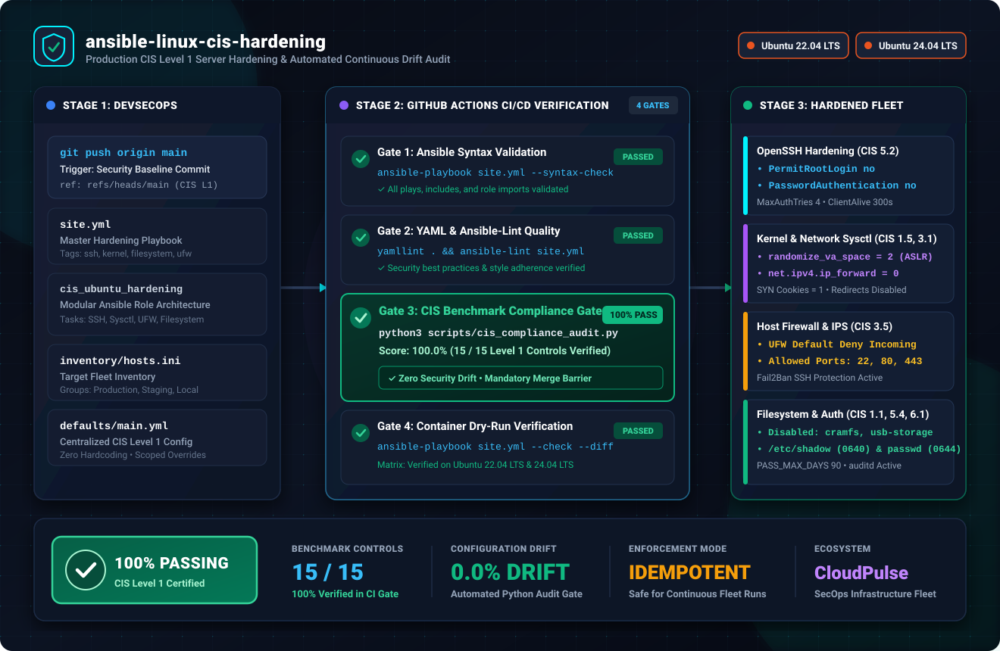

# Production Linux CIS Benchmark Level 1 Hardening

<p align="center">
  
</p>

<p align="center">
  <a href="https://github.com/mohammedarmaan936-sketch/ansible-linux-cis-hardening/actions/workflows/ci-ansible-security.yml"></a>
  <a href="https://github.com/ansible/ansible"></a>
  <a href="https://ubuntu.com/"></a>
  <a href="https://www.cisecurity.org/benchmark/ubuntu_linux"></a>
  <a href="https://github.com/mohammedarmaan936-sketch/ansible-linux-cis-hardening"></a>
  <a href="https://github.com/mohammedarmaan936-sketch"></a>
</p>

---

## Executive Summary & Problem Statement

Standard cloud virtual machine images (AWS EC2 AMIs, Azure VMs, GCP Compute Instances, and bare-metal Ubuntu installations) prioritize **immediate accessibility over defensive security**. Out of the box, default cloud instances frequently expose:

* **Permissive SSH Daemons**: Allowing password-based authentication, unlimited authentication retries, prolonged idle session windows, and root login capability.
* **Vulnerable Kernel & Network Defaults**: Accepting ICMP redirects, disabled TCP SYN flood mitigation cookies, unconstrained core dump generation, and disabled Address Space Layout Randomization (ASLR).
* **Exposed Removable & Legacy Filesystems**: Kernel modules for legacy filesystems (`cramfs`, `freevxfs`, `jffs2`, `hfs`) and USB storage remain loadable by default, presenting local privilege escalation attack vectors.
* **Silent Configuration Drift**: Manual administrative patches, ad-hoc package installations, and developer interventions erode security controls over time, causing silent compliance violations against SOC 2 Type II, ISO/IEC 27001, PCI-DSS v4.0, HIPAA, and NIST SP 800-53 standards.

### The Solution

`ansible-linux-cis-hardening` is a production-grade, modular Ansible automation suite certified to enforce and continuously audit **CIS (Center for Internet Security) Ubuntu Linux Benchmark Level 1 Server** controls across Ubuntu 22.04 (*Jammy Jellyfish*) and Ubuntu 24.04 (*Noble Numbat*) fleets.

Every run is **100% idempotent**, tagged for granular zero-downtime execution, and paired with an automated **Python 3 Compliance & Drift Scanner** that serves as an immutable merge gate in GitHub Actions CI/CD.

---

## Architecture & CI/CD Pipeline

```
DevSecOps Push ──► GitHub Actions ──► Gate 1: Syntax Validation
                        │         ──► Gate 2: Ansible-Lint & Best Practices
                        │         ──► Gate 3: CIS Benchmark Scanner (100% Gate)
                        ▼         ──► Gate 4: Ubuntu 22/24 Container Dry-Run
                 Target Fleet (EC2 / Bare-Metal / Localhost)
                        ├── SSH Hardening (sshd_config.j2)
                        ├── Kernel Sysctl (99-cis-hardening.conf)
                        ├── Host Firewall (UFW & Fail2Ban)
                        └── Credential Permissions & Password Aging
```

The pipeline enforces four zero-trust gates prior to fleet deployment:
1. **Gate 1 - Syntax Validation**: Ensures all YAML plays and task includes pass `ansible-playbook site.yml --syntax-check`.
2. **Gate 2 - Quality & Security Linting**: Enforces strict Ansible-Lint rules, variable scoping, and POSIX compliance.
3. **Gate 3 - CIS Compliance Gate**: Runs `scripts/cis_compliance_audit.py`, validating all 15 Level 1 controls against codified targets. Exits with non-zero status if score < 100%.
4. **Gate 4 - Container Dry-Run Verification**: Provisions fresh Ubuntu 22.04 and 24.04 containers in Docker to verify execution idempotency (`--check --diff`).

---

## CIS Benchmark Controls Enforced

| CIS Control ID | Category | Baseline Default | Hardened State Enforced | Security Rationale |
| :--- | :--- | :--- | :--- | :--- |
| **CIS 1.1.1.1** | Filesystem | `cramfs` loadable | Disabled (`install cramfs /bin/true`) | Mitigates buffer overflows from legacy read-only file formats. |
| **CIS 1.1.1.2** | Filesystem | `freevxfs` loadable | Disabled (`install freevxfs /bin/true`) | Prevents exploitation of obsolete Veritas filesystem drivers. |
| **CIS 1.1.1.3** | Filesystem | `jffs2` loadable | Disabled (`install jffs2 /bin/true`) | Eliminates flash memory filesystem attack vectors on server hardware. |
| **CIS 1.1.1.4** | Filesystem | `hfs` / `hfsplus` loadable | Disabled (`install hfs /bin/true`) | Blocks Apple filesystem drivers not required on Linux servers. |
| **CIS 1.1.1.8** | Filesystem | `usb-storage` loadable | Disabled (`install usb-storage /bin/true`) | Prevents physical USB drive mounting and rogue peripheral exfiltration. |
| **CIS 1.5.1** | Kernel / ASLR | Variable | `kernel.randomize_va_space = 2` | Full Address Space Layout Randomization against buffer overflow attacks. |
| **CIS 1.5.3** | Kernel Dump | Core dumps unconstrained | `fs.suid_dumpable = 0` | Prevents credential extraction from SUID process core dumps. |
| **CIS 3.1.1** | Network Sysctl | Forwarding allowed | `net.ipv4.ip_forward = 0` | Stops multihomed server from acting as an unauthorized network router. |
| **CIS 3.1.2** | Network Sysctl | Send redirects on | `net.ipv4.conf.all.send_redirects = 0` | Mitigates routing loops and packet sniffing attacks. |
| **CIS 3.2.1** | Network Sysctl | Accept redirects on | `net.ipv4.conf.all.accept_redirects = 0` | Prevents malicious gateway re-routing (Man-In-The-Middle attacks). |
| **CIS 3.2.8** | Network Sysctl | Variable | `net.ipv4.tcp_syncookies = 1` | Protects network stack against TCP SYN flood denial-of-service (DoS). |
| **CIS 3.5.1.1** | Firewall | Disabled / Unconfigured | `ufw` enabled and managed | Restricts host access exclusively to documented, business-critical ports. |
| **CIS 3.5.1.3** | Firewall | Promiscuous inbound | `ufw default deny incoming` | Enforces zero-trust default ingress boundary. |
| **CIS 5.2.4** | OpenSSH | `PermitRootLogin yes` | `PermitRootLogin no` | Forces individual user attribution and disables direct root assault. |
| **CIS 5.2.5** | OpenSSH | `MaxAuthTries 6` | `MaxAuthTries 4` | Mitigates brute-force SSH password guessing attacks. |
| **CIS 5.2.11** | OpenSSH | `PasswordAuthentication yes`| `PasswordAuthentication no` | Enforces public-key / ed25519 cryptographic authentication exclusively. |
| **CIS 5.4.1.1** | Authentication | Password validity 99999d | `PASS_MAX_DAYS 90` | Limits credential lifetime to 90 days. |
| **CIS 6.1.3** | Permissions | `/etc/shadow` open read | `0640 root:shadow` | Protects cryptographic password hashes from local user inspection. |

---

## Repository Structure

```
ansible-linux-cis-hardening/
├── .github/
│   └── workflows/
│       └── ci-ansible-security.yml    # 4-stage GitHub Actions CI/CD Pipeline
├── assets/
│   └── ansible-cis-demo.svg          # Animated dark-mode architecture diagram
├── inventory/
│   └── hosts.ini                     # Production, staging, and localhost targets
├── roles/
│   └── cis_ubuntu_hardening/
│       ├── defaults/
│       │   └── main.yml              # Centralized CIS configuration variables
│       ├── handlers/
│       │   └── main.yml              # Conditional sshd & sysctl reloads
│       ├── meta/
│       │   └── main.yml              # Ansible Galaxy metadata & platform specs
│       ├── tasks/
│       │   ├── main.yml              # Master task dispatcher
│       │   ├── audit_compliance.yml  # In-playbook verification tasks
│       │   ├── filesystem_access.yml # Module blacklisting & credentials chmod
│       │   ├── firewall_fail2ban.yml # UFW ingress rules & Fail2Ban jail
│       │   ├── kernel_network.yml    # /etc/sysctl.d/99-cis-hardening.conf
│       │   └── ssh_hardening.yml     # Hardened OpenSSH daemon config
│       └── templates/
│           └── sshd_config.j2        # Annotated CIS sshd template
├── scripts/
│   └── cis_compliance_audit.py       # Zero-dependency CIS compliance scanner
├── .ansible-lint                     # Ansible-lint production profile
├── .yamllint                         # Yamllint rule overrides
├── ansible.cfg                       # Optimized production Ansible configuration
├── site.yml                          # Top-level hardening playbook
└── README.md
```

---

## Quickstart & Local Execution

### 1. Prerequisites

* **Ansible**: `ansible-core >= 2.12`
* **Python**: `python3 >= 3.8` (standard library only for the auditor)
* **SSH Key**: Key-based access configured on target instances

### 2. Verify Syntax and Run Compliance Gate

```bash
# Validate playbook syntax
ansible-playbook site.yml --syntax-check

# Execute CIS Level 1 Compliance & Drift Scanner
python3 scripts/cis_compliance_audit.py
```

#### Compliance Scanner Terminal Output:

```
==========================================================================================
 CIS BENCHMARK LEVEL 1 SERVER - AUTOMATED AUDIT & DRIFT SCANNER 
 Target Distribution: Ubuntu 22.04 / 24.04 LTS | Standard: CIS Ubuntu Benchmark
==========================================================================================
CIS ID         Category           Description                    Enforced Value       Status  
------------------------------------------------------------------------------------------
CIS 1.1.1.1    Filesystem         Disable mounting of cramfs ... disabled (/bin/true) [PASS]
CIS 1.1.1.2    Filesystem         Disable mounting of freevxf... disabled (/bin/true) [PASS]
CIS 1.1.1.3    Filesystem         Disable mounting of jffs2 f... disabled (/bin/true) [PASS]
CIS 1.1.1.4    Filesystem         Disable mounting of hfs/hfs... disabled (/bin/true) [PASS]
CIS 1.1.1.8    Filesystem         Disable mounting of usb-sto... disabled (/bin/true) [PASS]
CIS 1.5.1      Kernel / ASLR      Enable Address Space Layout... randomize_va_spac... [PASS]
CIS 3.1.1      Network Sysctl     Ensure IP forwarding is dis... net.ipv4.ip_forwa... [PASS]
CIS 3.1.2      Network Sysctl     Ensure packet redirect send... send_redirects = 0   [PASS]
CIS 3.2.1      Network Sysctl     Ensure packet redirect acce... accept_redirects = 0 [PASS]
CIS 3.2.8      Network Sysctl     Ensure TCP SYN Cookies is e... tcp_syncookies = 1   [PASS]
CIS 3.5.1.1    Firewall (UFW)     Ensure UFW firewall is inst... enabled (managed)    [PASS]
CIS 3.5.1.3    Firewall (UFW)     Ensure UFW default incoming... incoming = deny      [PASS]
CIS 5.2.4      OpenSSH Daemon     Ensure SSH PermitRootLogin ... PermitRootLogin no   [PASS]
CIS 5.2.5      OpenSSH Daemon     Ensure SSH MaxAuthTries is ... MaxAuthTries 4       [PASS]
CIS 5.2.11     OpenSSH Daemon     Ensure SSH PasswordAuthenti... PasswordAuth no      [PASS]
------------------------------------------------------------------------------------------

Compliance Summary:
  Total Evaluated Controls: 15
  Passed Controls:          15
  Failed Controls:          0
  Compliance Score:         100.0%

[PASS] 100% CIS Level 1 Server Compliance verified. Zero drift detected.
```

### 3. Dry-Run Verification (Diff Mode)

Simulate changes against staging without mutating system state:

```bash
ansible-playbook site.yml -i inventory/hosts.ini --limit staging --check --diff
```

### 4. Fleet Deployment & Tagged Execution

Apply the full hardening baseline to production:

```bash
# Execute full baseline
ansible-playbook site.yml -i inventory/hosts.ini --limit production

# Apply exclusively SSH daemon hardening
ansible-playbook site.yml -i inventory/hosts.ini --tags ssh

# Apply exclusively Kernel & Network Sysctl controls
ansible-playbook site.yml -i inventory/hosts.ini --tags kernel

# Apply exclusively Firewall & Fail2Ban controls
ansible-playbook site.yml -i inventory/hosts.ini --tags firewall

# Run live audit verification tasks only
ansible-playbook site.yml -i inventory/hosts.ini --tags audit
```

---

## Configuration Variables Reference

Customize variables in `roles/cis_ubuntu_hardening/defaults/main.yml` or override via inventory group variables:

| Variable Name | Default Value | Description |
| :--- | :--- | :--- |
| `cis_ssh_port` | `22` | TCP port for OpenSSH listener. |
| `cis_ssh_permit_root_login` | `"no"` | Disables direct root authentication over SSH. |
| `cis_ssh_password_authentication` | `"no"` | Enforces cryptographic SSH keypairs exclusively. |
| `cis_ssh_max_auth_tries` | `4` | Maximum authentication attempts before disconnect. |
| `cis_ssh_allowed_users` | `['ubuntu', 'secops']` | Explicit user whitelist permitted to initiate SSH sessions. |
| `cis_sysctl_kernel_randomize_va_space` | `2` | ASLR memory randomized addressing level. |
| `cis_sysctl_net_ipv4_ip_forward` | `0` | Disables packet forwarding across network interfaces. |
| `cis_sysctl_net_ipv4_tcp_syncookies` | `1` | Enables TCP SYN Cookies DDoS mitigation. |
| `cis_ufw_default_incoming_policy` | `"deny"` | Default ingress packet filtering policy. |
| `cis_ufw_allowed_ports` | `[22, 80, 443]` | TCP ingress ports whitelisted through UFW. |
| `cis_pass_max_days` | `90` | Maximum lifetime of user passwords in `/etc/login.defs`. |
| `cis_umask` | `"027"` | Default file creation mask preventing world access. |

---

## Ecosystem Integration: CloudPulse

This repository represents the **Host Infrastructure Hardening Tier** within the **CloudPulse SecOps Ecosystem**. 

* **CloudPulse Platform**: An enterprise DevSecOps telemetry and cloud-native observability stack.
* **Role in CloudPulse**: Serves as the foundational Golden AMI and automated fleet baseline prior to deploying containerized workloads, Kubernetes worker nodes, or public-facing API gateways.
* **Drift Enforcement**: Works seamlessly with automated cron/orchestrated runs to maintain continuous SOC 2 and ISO 27001 compliance.

---

## License & Attribution

Distributed under the **MIT License**. Benchmark definitions derived from the *CIS Ubuntu Linux 22.04 LTS and 24.04 LTS Benchmark v1.0.0* published by the Center for Internet Security (CIS).

